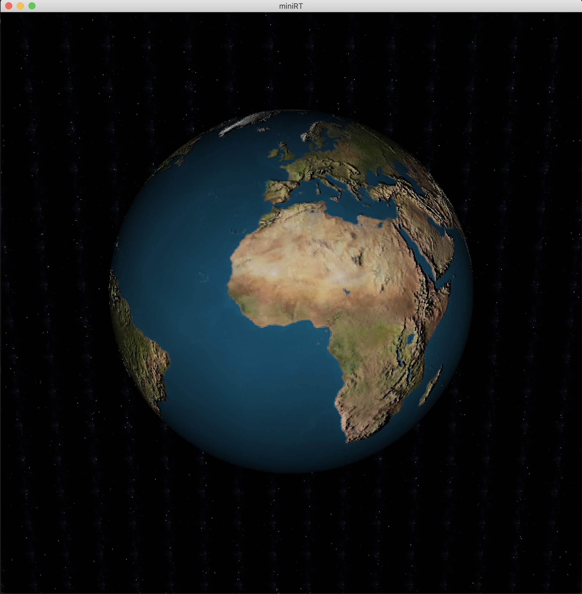
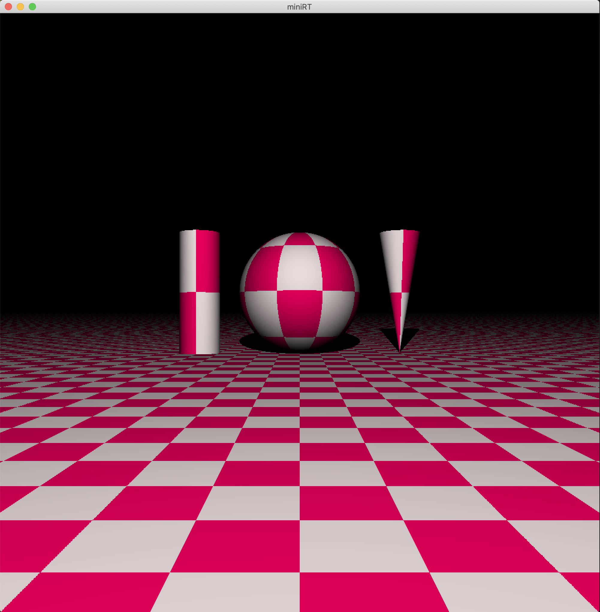
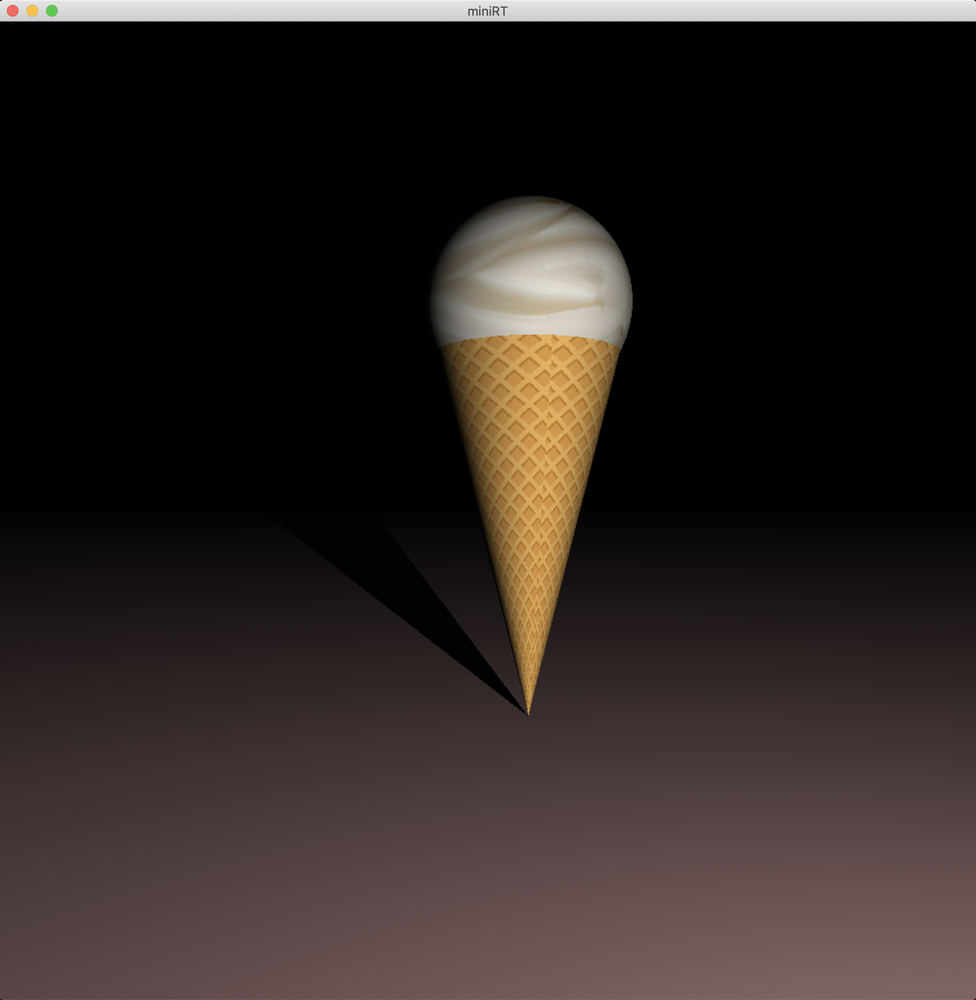
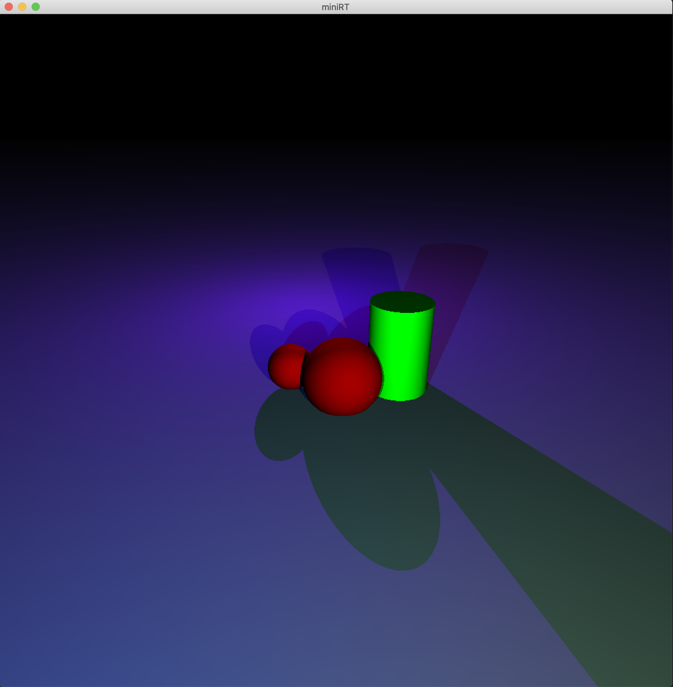
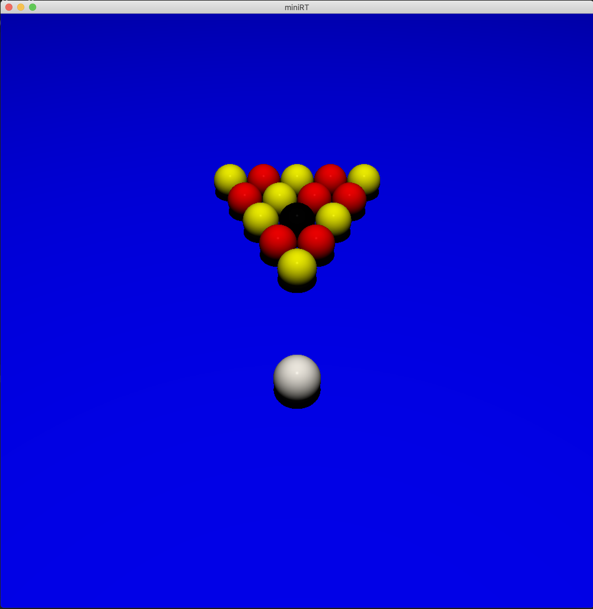
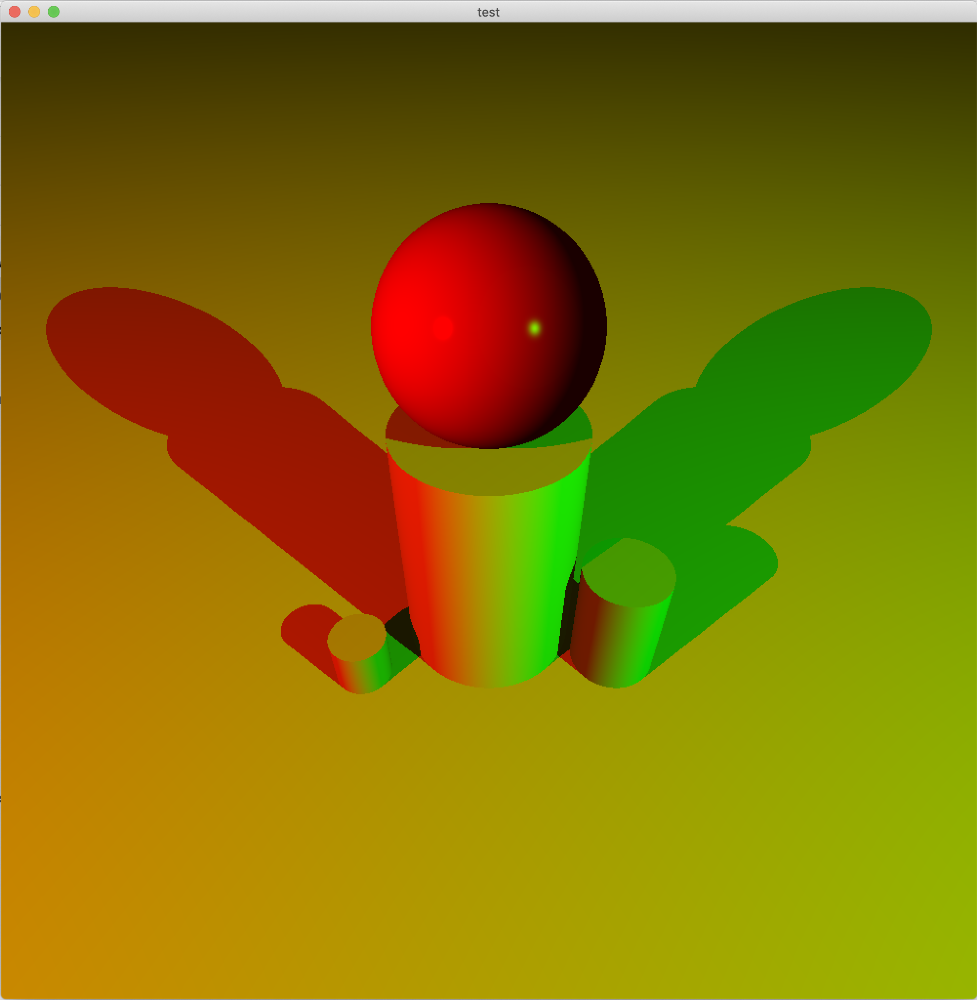
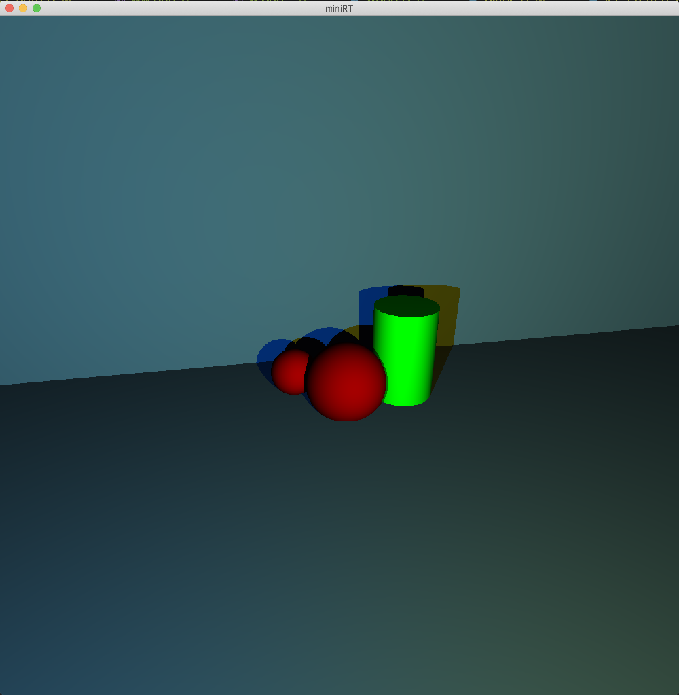
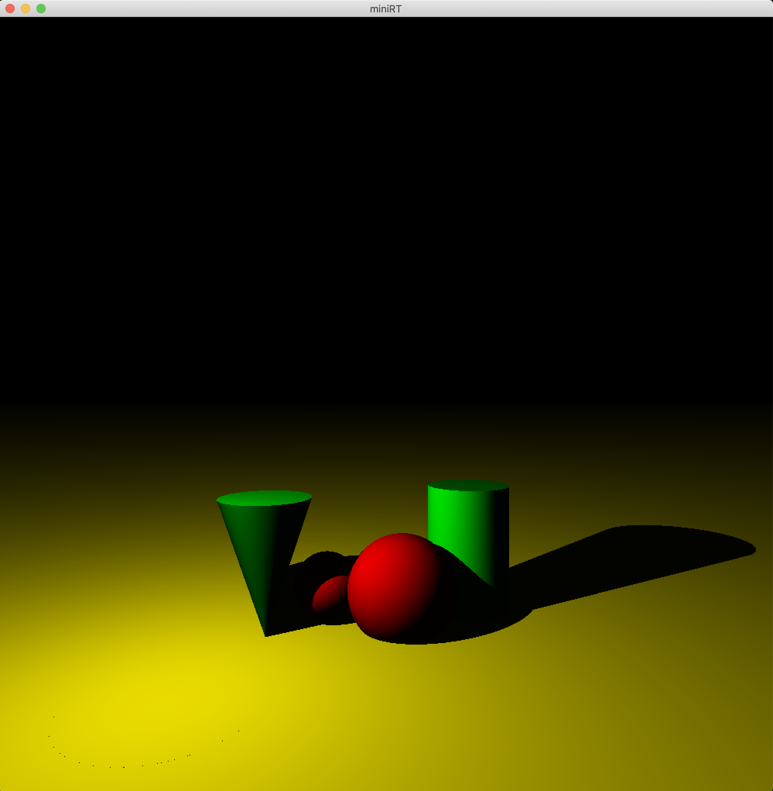
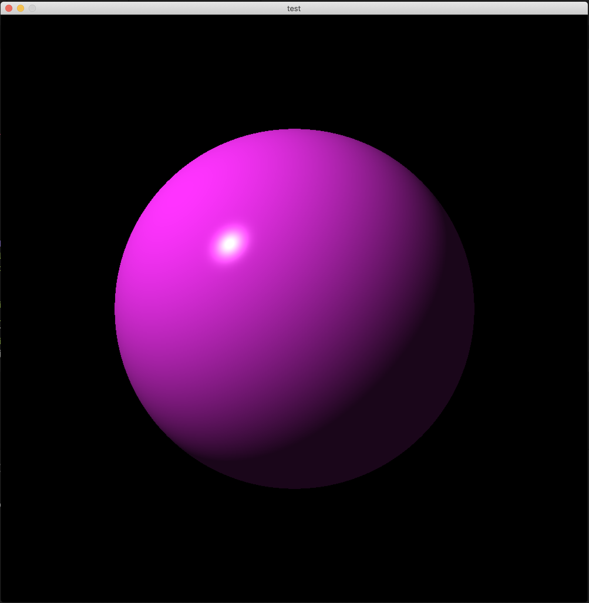
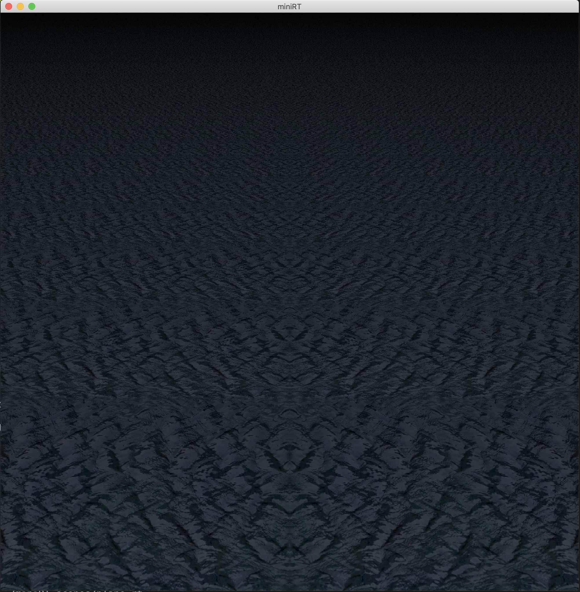

# MiniRT - 42 Network Project

**MiniRT** is a minimal Ray Tracer project created as part of the 42 Network curriculum. This project focuses on building a simple, efficient ray-tracing engine from scratch, rendering realistic 3D scenes with basic geometric shapes, lighting, and shading. Through this project, students gain a deep understanding of computer graphics fundamentals, including ray-object intersection calculations, light modeling, and the math behind 3D rendering.

## Features
- **Geometric Shapes**: Support for spheres, planes, and cylinders with custom parameters.
- **Lighting**: Ambient, diffuse, and specular lighting for realistic scene illumination.
- **Reflection and Shadows**: Basic reflection and shadow calculations for enhanced realism.
- **Multithreading**: Efficient use of CPU resources through multithreaded rendering (optional).
- **Error Handling**: Robust error handling for input validation and memory management.

## Project Requirements
This project was built in compliance with the 42 Network standards, using only authorized libraries and dependencies to reinforce low-level coding and problem-solving skills.

## Getting Started
- **Dependencies**: Built using C or C++, with minimal external dependencies.
- **Installation**: Compilation instructions are included in the `README.md`.
- **Usage**: Command-line options are available for loading and rendering scenes.

## Learning Outcomes
The MiniRT project provides hands-on experience with:
- Mathematical concepts in computer graphics, such as vectors, matrices, and transformations.
- Basics of light modeling, material properties, and camera setup.
- Code optimization techniques in ray tracing for performance improvements.

## Acknowledgments
This project was completed as part of the 42 Network curriculum, under the supervision and guidance of 42 peers and instructors.

## Gallery

